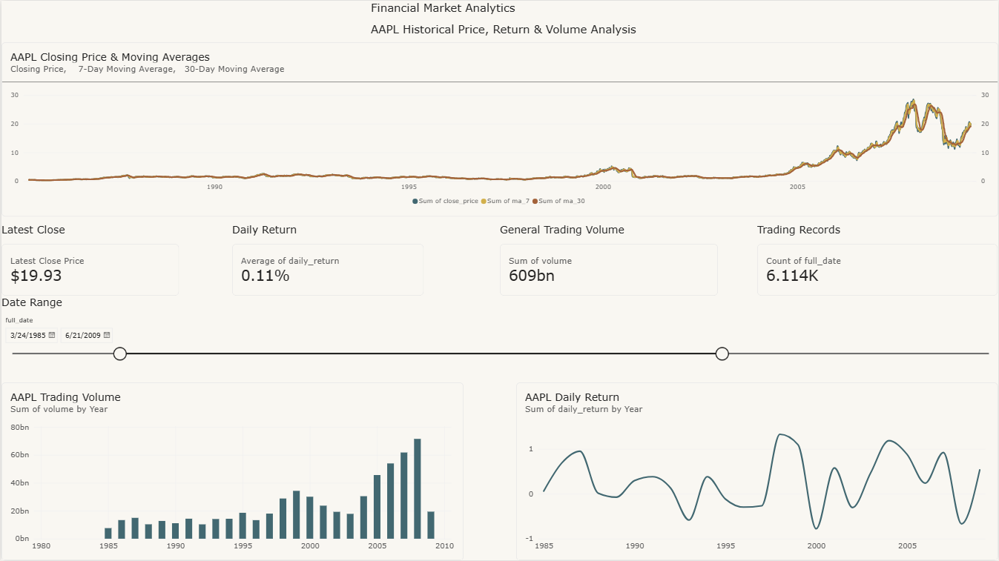

# Financial Market ETL Pipeline

An end-to-end data engineering project that extracts historical financial market data, transforms and validates the data using Python, loads it into a PostgreSQL dimensional data model, performs analytical SQL queries, and presents the processed data through an interactive Power BI dashboard.

# Project Overview

This project demonstrates the design and implementation of an end-to-end ETL pipeline for historical stock market data.

The pipeline processes historical Apple (AAPL) market data through the following stages:

1. **Extract** raw historical market data from the Kaggle Stock Market Dataset.
2. **Transform** the raw data into a clean and analysis-ready structure using Python and pandas.
3. **Validate** the dataset using automated data-quality checks.
4. **Load** the processed data into a PostgreSQL dimensional data model.
5. **Analyse** the warehouse data using SQL joins, aggregations, CTEs, window functions, ranking, and database views.
6. **Visualise** market performance through an interactive Power BI dashboard.

# Architecture


Kaggle Stock Market Dataset
            |
            v
     Python Extraction
       (extract.py)
            |
            v
       Raw CSV Data
            |
            v
 Python Transformation
     (transform.py)
            |
            v
   Data Validation
     (validate.py)
            |
            v
     Processed Data
            |
            v
    PostgreSQL Load
       (load.py)
            |
            v
   Dimensional Model
            |
            v
   SQL Analytical View
            |
            v
   Power BI Dashboard

   # ETL Pipeline

The project separates the ETL process into independent Python components so that each stage of the pipeline has a clear responsibility.

# 1. Extract

`src/extract.py`

The extraction stage retrieves the Stock Market Dataset using KaggleHub and extracts historical AAPL stock data.

The raw dataset contains:

- Date
- Open price
- High price
- Low price
- Close price
- Adjusted close price
- Trading volume

Raw data is stored locally in:


data/raw/AAPL.csv


Raw datasets are excluded from version control through `.gitignore`.

# 2. Transform

`src/transform.py`

The transformation stage prepares the raw market data for downstream analysis and database storage.

Transformations include:

- Converting dates to the correct datetime type
- Standardising column names
- Adding the ticker identifier
- Sorting observations chronologically
- Calculating daily percentage returns
- Calculating 7-day moving averages
- Calculating 30-day moving averages

The transformed dataset contains the following analytical fields:

| Field | Description |
|---|---|
| `daily_return` | Daily percentage change in closing price |
| `ma_7` | 7-day moving average of closing price |
| `ma_30` | 30-day moving average of closing price |

Processed data is written to:


data/processed/AAPL_clean.csv


# 3. Validate

`src/validate.py`

Before data is loaded into PostgreSQL, automated data-quality checks are performed.

The validation layer checks for:

- Missing expected columns
- Duplicate ticker/date combinations
- Missing values in core fields
- Zero or negative prices
- Negative trading volume
- Invalid OHLC relationships
- Incorrect ticker values

The AAPL dataset passed all core validation checks before being loaded into the database.

# 4. Load

`src/load.py`

The load stage connects Python to PostgreSQL using `psycopg` and loads the validated data into the dimensional model.

The loader:

- Inserts securities into `dim_security`
- Populates the date dimension
- Resolves dimension keys
- Loads market observations into `fact_market_price`
- Uses conflict handling to prevent duplicate security/date records
- Verifies row counts after loading

The completed load contains **9,909 historical AAPL market records**.

# Dimensional Data Model

The PostgreSQL database uses a dimensional model consisting of two dimension tables and one fact table.


       dim_security
       ┌───────────────┐
       │ security_id PK│
       │ ticker        │
       └───────┬───────┘
               │
               │
               ▼
      fact_market_price
┌────────────────────────────┐
│ market_price_id PK         │
│ security_id FK             │
│ date_id FK                 │
│ open_price                 │
│ high_price                 │
│ low_price                  │
│ close_price                │
│ adj_close                  │
│ volume                     │
│ daily_return               │
│ ma_7                       │
│ ma_30                      │
└─────────────▲──────────────┘
              │
              │
       ┌──────┴────────┐
       │   dim_date    │
       ├───────────────┤
       │ date_id PK    │
       │ full_date     │
       │ year          │
       │ month         │
       │ day           │
       └───────────────┘


# `dim_security`

Stores security-level information and provides a surrogate `security_id` used by the fact table.

# `dim_date`

Stores calendar attributes for each trading date and provides a surrogate `date_id`.

# `fact_market_price`

Stores the historical market observations and calculated analytical metrics.

A unique constraint on `(security_id, date_id)` prevents duplicate market observations for the same security and trading date.

# SQL Analytics

The project includes an analytical SQL layer built on top of the PostgreSQL dimensional model.

SQL scripts are stored in the `sql/` directory:

- `schema.sql` — creates the dimensional database schema
- `analysis.sql` — contains analytical queries
- `views.sql` — creates reusable analytical views

The analysis demonstrates:

- Multi-table joins between fact and dimension tables
- Aggregations and grouping
- Common Table Expressions (CTEs)
- Window functions
- `FIRST_VALUE`
- `RANK`
- Yearly return calculations
- Historical price analysis
- Trading volume analysis

# Example: Ranking Annual Market Performance

Annual performance is calculated by comparing the first and last closing prices for each year.

A SQL window function is then used to rank years from highest to lowest return.

```sql
RANK() OVER (
    PARTITION BY ticker
    ORDER BY yearly_return_pct DESC
) AS performance_rank
```

For the historical AAPL dataset, the analysis identified **2004** as the highest-ranked year in the dataset, with an approximate annual return of **202.63%**.

# Analytical Database View

Power BI consumes data from the PostgreSQL view:

```sql
vw_market_prices
```

The view combines the dimensional model into an analysis-ready dataset containing:

- Ticker
- Trading date
- Year, month and day
- OHLC prices
- Adjusted closing price
- Trading volume
- Daily return
- 7-day moving average
- 30-day moving average

This provides a reusable analytical interface between the underlying database model and downstream BI applications.

# Project Structure


financial-market-etl/
│
├── data/
│   ├── raw/
│   └── processed/
│
├── powerbi/
│   └── financial_market_dashboard.pbix
│
├── sql/
│   ├── schema.sql
│   ├── analysis.sql
│   └── views.sql
│
├── src/
│   ├── extract.py
│   ├── transform.py
│   ├── validate.py
│   └── load.py
│
├── .gitignore
├── README.md
└── requirements.txt


The raw and processed datasets are excluded from version control and can be regenerated by running the ETL pipeline.

# Dashboard Preview



# How to Run the Project

# 1. Clone the repository

```bash
git clone https://github.com/Warran-G/financial-market-etl.git
cd financial-market-etl
```

# 2. Install Python dependencies

```bash
pip install -r requirements.txt
```

# 3. Extract the raw market data

```bash
python src/extract.py
```

This downloads the source dataset and creates the raw AAPL CSV file locally.

# 4. Transform the dataset

```bash
python src/transform.py
```

This creates the cleaned and analysis-ready dataset in:

```text
data/processed/AAPL_clean.csv
```

# 5. Validate the processed data

```bash
python src/validate.py
```

The validation process checks schema completeness, duplicates, missing core values, invalid prices, invalid volume, OHLC consistency, and ticker integrity.

A successful run should end with:

```text
VALIDATION PASSED
```

# 6. Create the PostgreSQL database

Create a PostgreSQL database named:

```text
financial_market
```

Then run the schema script:

```bash
psql -U postgres -d financial_market -f sql/schema.sql
```

# 7. Load the data into PostgreSQL

```bash
python src/load.py
```

The loader securely prompts for the PostgreSQL password at runtime.

A successful load should result in approximately:

```text
dim_security rows: 1
dim_date rows: 9,909
fact_market_price rows: 9,909
```

# 8. Create the analytical view

```bash
psql -U postgres -d financial_market -f sql/views.sql
```

# 9. Run the analytical SQL

```bash
psql -U postgres -d financial_market -f sql/analysis.sql
```

# 10. Open the Power BI Dashboard

Open:

```text
powerbi/financial_market_dashboard.pbix
```

The dashboard connects to the local PostgreSQL database and consumes data through the `vw_market_prices` view.

# Key Data Engineering Concepts Demonstrated

This project demonstrates practical experience with:

- ETL pipeline development
- Data extraction from an external dataset
- Data cleaning and transformation
- Automated data-quality validation
- Financial time-series calculations
- PostgreSQL database design
- Dimensional data modelling
- Primary and foreign keys
- Data integrity constraints
- Python-to-database integration
- SQL joins and aggregations
- Common Table Expressions
- Window functions
- Analytical database views
- Power BI integration
- Git-based version control

# Future Improvements

Possible extensions include:

- Support for multiple stock tickers
- Dynamic ticker configuration rather than a fixed AAPL pipeline
- Batch loading or PostgreSQL `COPY` for improved loading performance
- Incremental data loading
- Logging and exception handling
- Automated unit and data-quality tests
- Pipeline orchestration
- Dockerised PostgreSQL and ETL environment
- Cloud database deployment
- Scheduled pipeline execution
- Additional date-dimension attributes such as quarter and day of week
- Additional financial indicators and portfolio analytics

# Data Source

Historical financial market data is sourced from the Kaggle Stock Market Dataset by Jackson Crow.

The project currently uses historical Apple Inc. (`AAPL`) stock-market data.

# Project Purpose

This project was built as a practical demonstration of an end-to-end data engineering workflow, covering data acquisition, transformation, validation, relational modelling, SQL analytics, and business intelligence reporting.